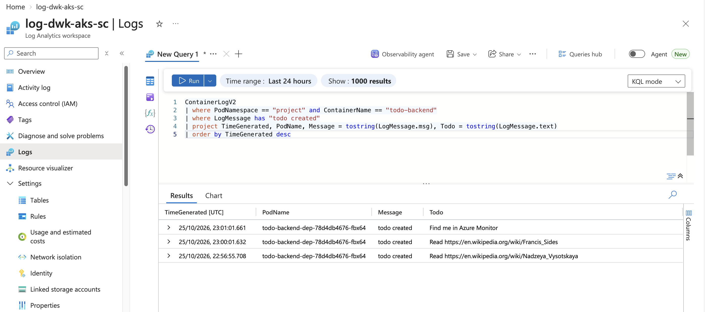

# DevOps with Kubernetes 2026

Exercise submissions for [DevOps with Kubernetes](https://courses.mooc.fi/org/uh-cs/courses/devops-with-kubernetes-2026) (University of Helsinki). Each app lives in its own directory with its own README, and every exercise has a GitHub release tagged with the exercise number.

## Exercises

### Chapter 2

- [1.1.](https://github.com/priku/k8s-course/tree/1.1/log-output)
- [1.2.](https://github.com/priku/k8s-course/tree/1.2/todo-project)
- [1.3.](https://github.com/priku/k8s-course/tree/1.3/log-output)
- [1.4.](https://github.com/priku/k8s-course/tree/1.4/todo-project)
- [1.5.](https://github.com/priku/k8s-course/tree/1.5/todo-project)
- [1.6.](https://github.com/priku/k8s-course/tree/1.6/todo-project)
- [1.7.](https://github.com/priku/k8s-course/tree/1.7/log-output)
- [1.8.](https://github.com/priku/k8s-course/tree/1.8/todo-project)
- [1.9.](https://github.com/priku/k8s-course/tree/1.9/ping-pong)
- [1.10.](https://github.com/priku/k8s-course/tree/1.10/log-output)
- [1.11.](https://github.com/priku/k8s-course/tree/1.11/log-output) ([ping-pong](https://github.com/priku/k8s-course/tree/1.11/ping-pong))
- [1.12.](https://github.com/priku/k8s-course/tree/1.12/todo-project)
- [1.13.](https://github.com/priku/k8s-course/tree/1.13/todo-project)

### Chapter 3

- [2.1.](https://github.com/priku/k8s-course/tree/2.1/log-output) ([ping-pong](https://github.com/priku/k8s-course/tree/2.1/ping-pong))
- [2.2.](https://github.com/priku/k8s-course/tree/2.2/todo-backend)
- [2.3.](https://github.com/priku/k8s-course/tree/2.3/log-output) ([ping-pong](https://github.com/priku/k8s-course/tree/2.3/ping-pong))
- [2.4.](https://github.com/priku/k8s-course/tree/2.4/todo-project) ([todo-backend](https://github.com/priku/k8s-course/tree/2.4/todo-backend))
- [2.5.](https://github.com/priku/k8s-course/tree/2.5/log-output)
- [2.6.](https://github.com/priku/k8s-course/tree/2.6/todo-project)
- [2.7.](https://github.com/priku/k8s-course/tree/2.7/ping-pong)
- [2.8.](https://github.com/priku/k8s-course/tree/2.8/todo-backend)
- [2.9.](https://github.com/priku/k8s-course/tree/2.9/wiki-todo-generator)
- [2.10.](https://github.com/priku/k8s-course/tree/2.10/todo-backend)

### Chapter 4

On Azure Kubernetes Service instead of Google Kubernetes Engine (chapter 1 of the course allows other cloud providers). The cluster is in [`terraform`](https://github.com/priku/k8s-course/tree/3.4/terraform).

- [3.1.](https://github.com/priku/k8s-course/tree/3.1/ping-pong) ([terraform](https://github.com/priku/k8s-course/tree/3.1/terraform))
- [3.2.](https://github.com/priku/k8s-course/tree/3.2/ping-pong) ([log-output](https://github.com/priku/k8s-course/tree/3.2/log-output))
- [3.3.](https://github.com/priku/k8s-course/tree/3.3/ping-pong) ([terraform](https://github.com/priku/k8s-course/tree/3.3/terraform))
- [3.4.](https://github.com/priku/k8s-course/tree/3.4/ping-pong)
- [3.5.](https://github.com/priku/k8s-course/tree/3.5/project)
- [3.6.](https://github.com/priku/k8s-course/tree/3.6/project) ([workflow](https://github.com/priku/k8s-course/blob/3.6/.github/workflows/project.yaml))
- [3.7.](https://github.com/priku/k8s-course/tree/3.7/project) ([workflow](https://github.com/priku/k8s-course/blob/3.7/.github/workflows/project.yaml))
- [3.8.](https://github.com/priku/k8s-course/tree/3.8/project) ([workflow](https://github.com/priku/k8s-course/blob/3.8/.github/workflows/project-cleanup.yaml))
- [3.9.](https://github.com/priku/k8s-course/tree/3.9/project#dbaas-vs-diy-exercise-39)
- [3.10.](https://github.com/priku/k8s-course/tree/3.10/db-backup) ([terraform](https://github.com/priku/k8s-course/blob/3.10/terraform/backup.tf))
- [3.11.](https://github.com/priku/k8s-course/tree/3.11/project#resource-requests-and-limits-exercise-311)
- [3.12.](https://github.com/priku/k8s-course/tree/3.12/project#logs-in-azure-monitor-exercise-312) ([terraform](https://github.com/priku/k8s-course/blob/3.12/terraform/monitoring.tf))

Exercise 3.12: the log of a new todo in Azure Monitor (Log Analytics workspace `log-dwk-aks-sc`, see the [query](https://github.com/priku/k8s-course/tree/3.12/project#logs-in-azure-monitor-exercise-312)):

### Chapter 5

- [4.1.](https://github.com/priku/k8s-course/tree/4.1/ping-pong) ([log-output](https://github.com/priku/k8s-course/tree/4.1/log-output))
- [4.2.](https://github.com/priku/k8s-course/tree/4.2/project#health-checks-exercise-42)
- [4.3.](https://github.com/priku/k8s-course/tree/4.3/monitoring#prometheus-query-exercise-43)
