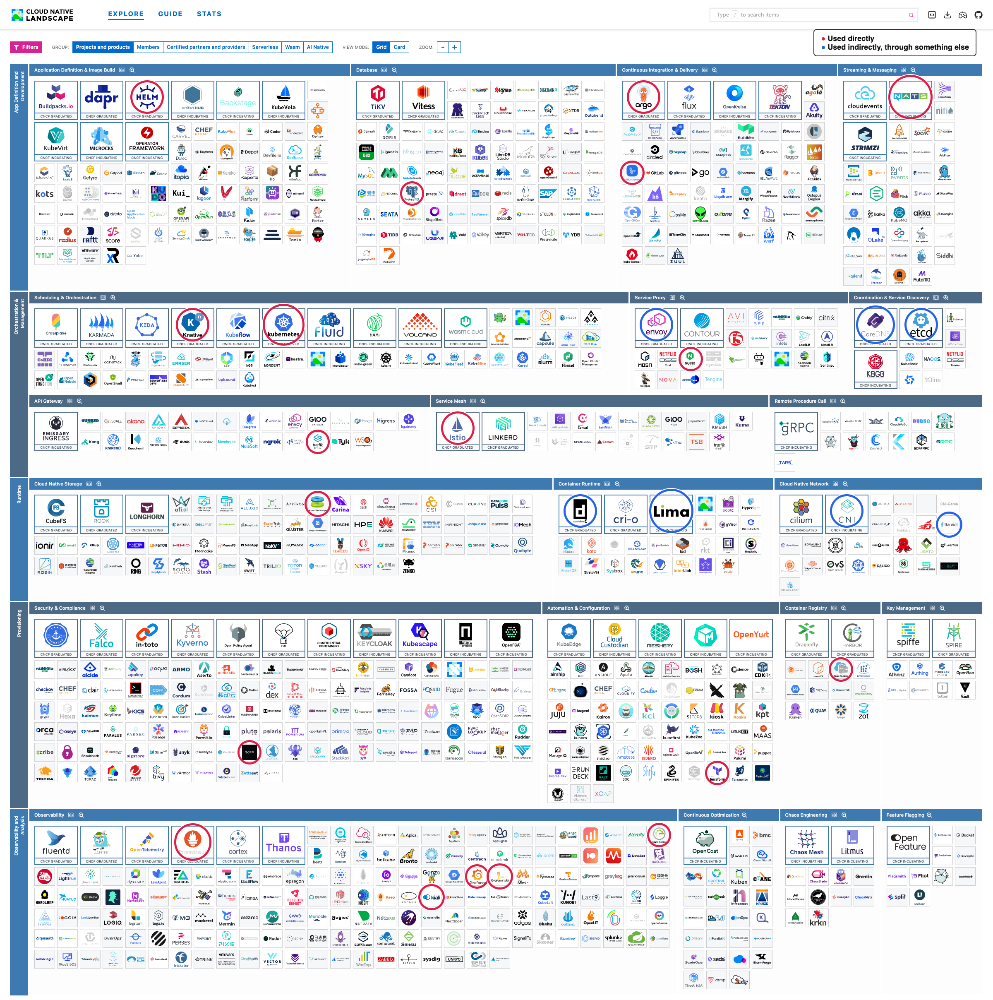

# Beyond Kubernetes

## Platform comparison: Rancher vs OpenShift (exercise 5.5)

**My pick: Rancher.** The exercise asks to pick one and argue for it, so this is deliberately one-sided.

- **Works with the Kubernetes you already have.** Rancher manages any conformant cluster, including imported AKS, EKS and GKE clusters. OpenShift is a platform of its own that you move onto.
- **It is plain Kubernetes.** What is learned on this course applies directly: Deployments, Ingress and the Gateway API. OpenShift adds its own concepts on top, such as Routes, Projects and DeploymentConfigs, and its own `oc` command.
- **Fully open source, without a subscription to get started.** All of Rancher is free to run, and support is an optional purchase. OpenShift is a paid subscription product, and its community version OKD does not come with the same support.
- **Scales down as well as up.** The same family runs from K3s on a Raspberry Pi or in k3d, as on this course, up to RKE2 for strict environments. OpenShift has much larger minimum requirements for a full cluster.
- **Many clusters from one place.** Managing a fleet across clouds and data centres is the very thing Rancher was built for, including GitOps with Fleet.
- **Less lock-in.** Leaving Rancher leaves the clusters running as ordinary Kubernetes. Leaving OpenShift means migrating away from everything that is specific to it.

What OpenShift does better, to be fair:

- More is included and integrated from the start: image builds, a registry, pipelines and monitoring.
- Stricter security by default, such as not running containers as root.
- A single vendor supports the whole stack from the operating system up, which large regulated organizations often require.

For a small team that wants to stay close to upstream Kubernetes, these do not outweigh the cost and the lock-in.

## CNCF landscape (exercise 5.8)

The [Cloud Native Landscape](https://landscape.cncf.io/), the view "Projects and products". Red marks what I used, and blue what something I used depended on.

### Used directly

| Project | Where |
|---|---|
| Kubernetes | The whole course, in k3d and AKS |
| Helm | To install the monitoring stack in exercise 2.10 |
| Prometheus | Metrics in 2.10, a query in 4.3, the analysis of the canary in 4.4, and the data of Kiali in 5.2 and 5.3 |
| Grafana | Dashboards and logs in 2.10 |
| Grafana Loki | Log storage in 2.10 |
| Argo | Argo Rollouts for the canary in 4.4, and Argo CD for GitOps in 4.7–4.10 |
| Istio | The service mesh in 5.2 and 5.3 |
| Kiali | The traffic graphs in 5.2 and 5.3 |
| NATS | The messages from todo-backend to broadcaster in 4.6 |
| PostgreSQL | The database of ping-pong in 2.7 and of the project in 2.8 |
| Knative | Serverless in 5.6 and 5.7 |
| Traefik | The Ingress controller of k3d, from the first Ingress exercises on |
| NGINX | The server of the sites in 5.1 and of the Wikipedia app in 5.4 |
| GitHub Actions | The pipelines in 3.6–3.8 and 4.7–4.10 |
| Terraform | The Azure infrastructure of Chapter 4 |
| SOPS | The encrypted Secrets, since 2.7 |
| Azure Registry | The images of the AKS deployments, since 3.1 |
| Azure Monitor | The container logs in 3.12 |
| Azure Disk Storage | The volumes of Postgres and the image cache in AKS |

### Used indirectly

| Project | Through |
|---|---|
| containerd | The container runtime of k3s and AKS |
| CoreDNS | The DNS that lets Services be called by name, in both clusters |
| etcd | The cluster data of the AKS control plane |
| Envoy | The Gateway of AKS (`approuting-istio`), the Istio waypoint in 5.3, and Kourier in 5.6 |
| Flannel | The network of k3d, through k3s |
| Container Network Interface (CNI) | The plugin interface of Flannel and Azure CNI, which I also had to debug when installing Istio in 5.2 |
| Lima | The VM of Colima, which runs Docker on my Mac |

### Used but not in this view

Docker, k3d, k3s, Kustomize, Grafana Alloy, kube-state-metrics and Azure Kubernetes Service are not among the logos of this view, so they have no circle.
