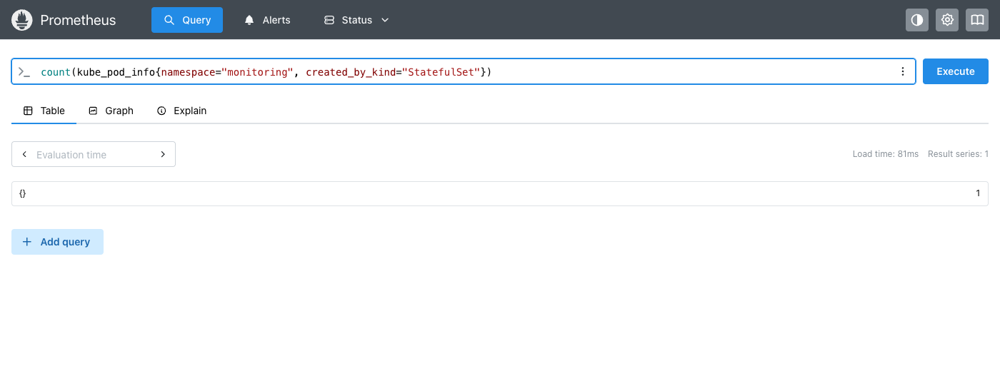

# Monitoring

Metrics and logs for the whole cluster, installed with [Helm](https://helm.sh) into the namespace `monitoring` (exercise 2.10):

- **Prometheus** collects and stores cluster metrics
- **Loki** stores container logs
- **Alloy** (the `k8s-monitoring` chart) reads pod logs from the nodes and pushes them to Loki
- **Grafana** shows both, with Prometheus and Loki set up as datasources

## Install

```bash
helm repo add prometheus-community https://prometheus-community.github.io/helm-charts
helm repo add grafana https://grafana.github.io/helm-charts
helm repo update

# Storage first, then the log collector, then Grafana
helm upgrade --install prom prometheus-community/prometheus --version 29.38.2 \
  --namespace monitoring --create-namespace --values prom-values.yaml
helm upgrade --install loki grafana/loki --version 7.5.0 \
  --namespace monitoring --values loki-values.yaml
helm upgrade --install k8smon grafana/k8s-monitoring --version 4.5.5 \
  --namespace monitoring --values k8smon-values.yaml
helm upgrade --install grafana grafana/grafana --version 10.5.15 \
  --namespace monitoring --values grafana-values.yaml

helm list --namespace monitoring
kubectl get pods --namespace monitoring   # wait until everything is Running
```

The chart versions are pinned, so the install is the same every time (Prometheus 3.15, Loki 3.6, Alloy 1.21, Grafana 12.3).

## Values files

They follow the course material, with three changes for the current charts:

| File | What it sets |
|---|---|
| `prom-values.yaml` | No Alertmanager, no Pushgateway, no remote write. The material disables the Pushgateway with `pushgateway:`, but the chart's key is `prometheus-pushgateway:`, so it would still be installed. |
| `loki-values.yaml` | One Loki (`SingleBinary`) with filesystem storage. Also disables the memcached chunk and results caches: by default the chunk cache requests about 10 GiB of memory, which no k3d node has, so its pod stays `Pending`. The canary, which only writes test lines, is off too. |
| `k8smon-values.yaml` | Alloy reads pod logs from the node filesystem and pushes them to `loki-gateway`, with the cluster name `k3d-dwk`. |
| `grafana-values.yaml` | Prometheus and Loki as datasources. The password `admin` is only fine for a local cluster. |

## Grafana

```bash
kubectl port-forward --namespace monitoring svc/grafana 3000:80
# Open http://localhost:3000 and log in as admin / admin
```

In **Explore**, pick a datasource and switch to **Code**:

| Datasource | Query | Shows |
|---|---|---|
| Prometheus | `count by (namespace) (kube_pod_info)` | Pods per namespace |
| Loki | `{namespace="project"}` | All logs of the project |
| Loki | `{namespace="project", container="todo-backend"} \|= "todo rejected"` | Todos refused by [todo-backend](../todo-backend) |
| Loki | `{namespace="project", container="todo-backend"} \| json \| msg="request" and status >= 400` | Failed requests, using the JSON fields |

## Prometheus query (exercise 4.3)

Prometheus has its own UI behind the Service `prom-prometheus-server`:

```bash
kubectl port-forward svc/prom-prometheus-server -n monitoring 9090:80
# Open http://localhost:9090
```

The number of pods created by StatefulSets in the monitoring namespace:

```promql
count(kube_pod_info{namespace="monitoring", created_by_kind="StatefulSet"})
```

`kube_pod_info` comes from kube-state-metrics and has one series per pod; its label `created_by_kind` tells what created the pod (`ReplicaSet`, `StatefulSet`, `DaemonSet`, `Job`, …), so counting the series with that label gives the number of pods.



The result here is **1**, not 3 as in the course material. The query is the same; the difference is Loki. With the chart's defaults it has three StatefulSets (`loki`, `loki-chunks-cache` and `loki-results-cache`), but [`loki-values.yaml`](loki-values.yaml) turns the two memcached caches off, since they do not fit on the k3d nodes (see [Values files](#values-files)). The Prometheus chart itself creates no StatefulSets here, so the only StatefulSet pod in `monitoring` is `loki-0`. The exercise text says "prometheus namespace", but its own listing and this stack use `monitoring`. Broken down by StatefulSet, and over the whole cluster:

```promql
count by (created_by_name) (kube_pod_info{namespace="monitoring", created_by_kind="StatefulSet"})   # loki: 1
count by (namespace) (kube_pod_info{created_by_kind="StatefulSet"})                                  # monitoring 1, exercises 1, project 1
```

## Remove

```bash
helm uninstall grafana k8smon loki prom --namespace monitoring
kubectl delete namespace monitoring
```

Custom resource definitions installed by the charts stay in the cluster; they do nothing on their own.
