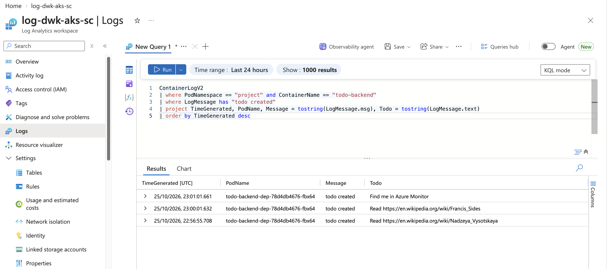

# The todo project with Kustomize

The todo project is three applications that are always deployed together: the frontend [todo-project](../todo-project), [todo-backend](../todo-backend) with its Postgres, and the hourly CronJob [wiki-todo-generator](../wiki-todo-generator). Since exercise 3.5 they are deployed with [Kustomize](https://kubectl.docs.kubernetes.io/references/kustomize/), which is built into `kubectl` (`kubectl apply -k`).

```
todo-project/manifests/kustomization.yaml          ┐ each app's manifests are a base:
todo-backend/manifests/kustomization.yaml          │ what is the same in every cluster
wiki-todo-generator/manifests/kustomization.yaml   ┘
project/base/   → the three apps together
project/k3d/    → base + Traefik Ingresses (local cluster, images from `k3d image import`)
project/aks/    → base + Gateway API routing, images from the registry acrdwkakssc.azurecr.io
```

Only what differs between the clusters is in the overlays:

| | k3d (`project/k3d`) | AKS (`project/aks`) |
|---|---|---|
| Images | `todo-project:v2.9` etc., imported into the cluster | `acrdwkakssc.azurecr.io/...`, set with the `images` field |
| Routing | Traefik Ingresses; a Middleware strips `/api` | Gateway `project-gateway` (`approuting-istio`) and HTTPRoute `project-route`; a `URLRewrite` filter strips `/api` |
| Storage | default storage class `local-path` | default storage class, an Azure Disk |

The bases leave out `storageClassName`, so every cluster uses its own default storage class.

## Deploy

The namespace and the database password are applied first: the password is a SOPS-encrypted Secret, which Kustomize cannot decrypt by itself.

```bash
kubectl apply -f manifests/project-namespace.yaml
sops --decrypt todo-backend/secrets/postgres-secret.enc.yaml | kubectl apply -f -

# Local k3d cluster
docker build -t todo-project:v2.9 todo-project
docker build -t todo-backend:v2.10 todo-backend
docker build -t wiki-todo-generator:v2.9 wiki-todo-generator
k3d image import todo-project:v2.9 todo-backend:v2.10 wiki-todo-generator:v2.9
kubectl apply -k project/k3d          # http://localhost:8081

# Azure Kubernetes Service (exercise 3.5)
az acr build --registry acrdwkakssc --image todo-project:v2.9 --platform linux/amd64 todo-project
az acr build --registry acrdwkakssc --image todo-backend:v2.10 --platform linux/amd64 todo-backend
az acr build --registry acrdwkakssc --image wiki-todo-generator:v2.9 --platform linux/amd64 wiki-todo-generator
kubectl config use-context aks-dwk-sc
kubectl apply -k project/aks
kubectl get gateway project-gateway -n project   # ADDRESS: the public IP of the project
```

`kubectl kustomize project/aks` prints the resulting manifests without applying them.

Changing the storage class of an existing claim is not allowed, so a cluster that still has the claims from before exercise 3.5 (with `storageClassName: local-path`) needs them deleted first, together with the Postgres StatefulSet. This deletes the data.

## Deployment pipeline (exercise 3.6)

[`.github/workflows/project.yaml`](../.github/workflows/project.yaml) deploys the project to AKS on every push that changes it:

1. **Sign in to Azure** with `azure/login` and GitHub's OIDC token. Entra ID trusts the token because of a federated credential on the managed identity `id-dwk-github-actions` ([`../terraform/github.tf`](../terraform/github.tf)): only jobs of this repository that run in the GitHub environment `aks` can use the identity. There are no passwords or keys in GitHub, only the IDs of the identity, tenant and subscription.
2. **Start the cluster** if the nightly stop has stopped it.
3. **Choose the namespace**: `main` goes to `project`, every other branch to a namespace of its own (exercise 3.7, see below).
4. **Build and push** the three images to ACR, tagged `<namespace>-<commit SHA>`.
5. **Deploy** with Kustomize: `kustomize edit set namespace` and `kustomize edit set image` put the namespace and the new tags into `project/aks`, and `kustomize build | kubectl apply` applies it. The database password is decrypted with SOPS using the workflow's own age key (the environment secret `SOPS_AGE_KEY`); `.sops.yaml` encrypts the project's Secret for it and for the personal key, and other Secrets for the personal key only.
6. **Wait** for the rollouts and write the address of the Gateway to the job summary.

| Course material (GCP) | Here (Azure) |
|---|---|
| Service account `github-actions-sa` | User-assigned managed identity `id-dwk-github-actions` |
| Workload Identity Pool and OIDC provider, `roles/iam.workloadIdentityUser` binding | Federated identity credential, subject `repo:priku/k8s-course:environment:aks` |
| `roles/artifactregistry.writer` | `AcrPush` on the registry |
| `roles/container.admin` | `Azure Kubernetes Service Cluster User Role` and `Azure Kubernetes Service RBAC Cluster Admin` on the cluster, `Azure Kubernetes Service Contributor Role` to start it |
| `google-github-actions/auth`, `get-gke-credentials` | `azure/login`, `azure/aks-set-context` with kubelogin |
| Artifact Registry | Azure Container Registry |

The frontend's Deployment uses the `Recreate` strategy: its image cache is a `ReadWriteOnce` Azure Disk that only one node can attach, and a rolling update would start the new pod, possibly on another node, before the old one lets go of the disk.

## A separate environment for each branch (exercise 3.7)

Every branch gets its own copy of the whole project: frontend, backend, its own Postgres with its own disk, the CronJob, and a Gateway with its own public IP. `main` is the production environment in the namespace `project`.

| Branch | Namespace | Images |
|---|---|---|
| `main` | `project` | `todo-project:project-<sha>`, … |
| `feature-x` | `feature-x` | `todo-project:feature-x-<sha>`, … |
| `feature/Blue_Sky` | `feature-blue-sky` | … |

Only branch pushes deploy; pushing an exercise tag does not. The namespace is the branch name made valid for Kubernetes: lowercase, characters other than `a-z`, `0-9` and `-` replaced with `-`, at most 63 characters. A branch whose name would land in `project`, `default`, `exercises`, `monitoring` or a system namespace (`kube-*`, `aks-*`) is refused, so a branch cannot overwrite production or the cluster's own namespaces. The database Secret is applied with `yq` into the target namespace, and `kustomize edit set namespace` moves every resource of the project there.

The address of each environment is in the summary of its workflow run, or:

```bash
kubectl get gateway project-gateway -n <namespace>
```

## Deleting a branch deletes its environment (exercise 3.8)

[`.github/workflows/project-cleanup.yaml`](../.github/workflows/project-cleanup.yaml) runs when a branch is deleted and deletes the branch's namespace. That removes the whole environment: the apps, the Gateway with its public IP, and the claims, whose Azure Disks are deleted with them. It then deletes the branch's images from ACR: the tags `<namespace>-<commit SHA>` of the three repositories, matched as whole tags so that deleting `feature` leaves the images of `feature-x` alone. The workflow's identity has `AcrDelete` on the registry for this. It computes the namespace from the branch name the same way as the deployment, refuses `main` and the reserved namespaces, and starts the cluster first if it is stopped.

GitHub runs workflows for branch delete events only from the default branch, so this workflow works once it is on `main`. It shares the concurrency group of the branch's deployment, so when a branch is deleted while its deployment still runs (as with `gh pr merge --delete-branch` right after a push), the deletion waits for the deployment to finish instead of racing it. For a branch that was deleted before that, run it by hand:

```bash
gh workflow run project-cleanup.yaml -f branch=<deleted branch>
```

Production images pile up too, three for every deployment of `main`. The ACR task `purge-old-project-images` ([`../terraform/acr-purge.tf`](../terraform/acr-purge.tf)) runs `acr purge` every Monday: it deletes `project-*` images older than a week, keeping the five newest of each repository, and untagged manifests. The hand-built version tags such as `v2.9` are not touched.

GitHub environment `aks` (Settings → Environments) holds the secrets `AZURE_CLIENT_ID`, `AZURE_TENANT_ID`, `AZURE_SUBSCRIPTION_ID` and `SOPS_AGE_KEY`.

## Logs in Azure Monitor (exercise 3.12)

GKE sends container logs to Cloud Logging by itself. The AKS counterpart is **Azure Monitor Container insights**, enabled in [`../terraform/monitoring.tf`](../terraform/monitoring.tf): the agent `ama-logs` on every node sends the stdout and stderr of the containers in the namespace `project` to the Log Analytics workspace `log-dwk-aks-sc`, table `ContainerLogV2`. todo-backend logs JSON (exercise 2.10), so the fields of each line are columns in `LogMessage`.

To find the log of a new todo:

1. Create a todo in the app.
2. In the Azure portal open **Kubernetes services → aks-dwk-sc → Monitoring → Logs** (or the workspace **log-dwk-aks-sc → Logs**), switch the editor to **KQL mode** and run:

```kusto
ContainerLogV2
| where PodNamespace == "project" and ContainerName == "todo-backend"
| where LogMessage has "todo created"
| project TimeGenerated, PodName, Message = tostring(LogMessage.msg), Todo = tostring(LogMessage.text)
| order by TimeGenerated desc
```

The same from the command line:

```bash
az monitor log-analytics query --workspace "$(az monitor log-analytics workspace show -g rg-dwk-aks-sc -n log-dwk-aks-sc --query customerId -o tsv)" \
  --analytics-query 'ContainerLogV2 | where PodNamespace == "project" and LogMessage has "todo created" | take 10' -o table
```

Logs arrive within a few minutes. To keep the cost down, only the namespace `project` is collected (`namespaceFilteringMode: Include`), only three tables (ContainerLogV2, KubePodInventory, KubeEvents), retention is the free 30 days, and ingestion stops at 0.2 GB a day.



## Resource requests and limits (exercise 3.11)

Every container of the project has resource requests and limits. The values come from `kubectl top pods --containers` while `hey` loaded the AKS deployment through the Gateway (about 50 concurrent users on `/` and `/api/todos`, roughly 1 300 requests per second):

| Container | Peak under load | Requests | Limits |
|---|---|---|---|
| todo-project | 162m CPU, 7Mi | 20m, 16Mi | 250m, 64Mi |
| todo-backend | 109m CPU, 7Mi | 20m, 16Mi | 250m, 64Mi |
| postgres | 62m CPU, 37Mi | 50m, 64Mi | 500m, 512Mi |
| wiki-todo-generator (CronJob) | one short run | 10m, 16Mi | 100m, 32Mi |
| db-backup (CronJob) | one short run | 20m, 32Mi | 250m, 128Mi |

- **Requests** are what the scheduler reserves on a node, so they follow normal use: small, so that the project and its branch environments still fit next to the cluster's own pods (the AKS-managed `istiod` alone requests 2 × 500m CPU and 2 × 2Gi).
- **Limits** leave room above the measured peaks. Going over the CPU limit only slows a container down (throttling), but going over the memory limit kills it (`OOMKilled`), so the memory limits have the larger margin. Postgres keeps up to 128MB of shared buffers by default, hence its 512Mi.

```bash
kubectl top pods -n project --containers
kubectl describe nodes | grep -A6 'Allocated resources'   # what the requests take of each node
```

The Gateway's Envoy proxies are managed by AKS and come with their own requests (100m, 128Mi). A `ResourceQuota` per namespace could cap what a branch environment may take in total; it is not used here because every pod in the namespace, including the managed Gateway pods, would then need limits.

## Database backups (exercise 3.10)

Production (`main`, namespace `project`) dumps its database every day with `pg_dump` and uploads it to Azure Blob Storage, authenticated with workload identity: no keys or Secrets for Azure. The CronJob and its ServiceAccount are the Kustomize component `components/db-backup`, which the deployment workflow adds for `main` only, so branch environments do not back up. See [`../db-backup`](../db-backup) for how it works and how to restore.

## DBaaS vs DIY (exercise 3.9)

The project's Postgres runs in the cluster as a StatefulSet with an Azure Disk ("do it yourself"). The managed alternative in Azure is **Azure Database for PostgreSQL – Flexible Server** ("database as a service"; Cloud SQL in the course material). Prices are Sweden Central list prices in October 2026.

| | DBaaS: Azure Database for PostgreSQL Flexible Server | DIY: Postgres StatefulSet in AKS (current) |
|---|---|---|
| **Getting started** | A Terraform resource (or a few clicks): server, version, size, firewall or private network. The app needs the server's host name and a login; with Entra ID authentication even the password can go, using workload identity. | A StatefulSet, a headless Service and a Secret that we write and keep up to date ourselves (`todo-backend/manifests/statefulset.yaml`). Needs Kubernetes knowledge: volume claim templates, storage classes, the Postgres 18 data directory change. |
| **Cost** | Paid separately from the cluster. The smallest server (Burstable B1ms, 1 vCore, 2 GiB) is about 0.0175 €/h, so about 12.8 €/month if it runs all the time, plus storage from 32 GB upwards at 0.12 €/GB/month (about 3.9 €/month). It can be stopped for up to 7 days at a time. | Runs on nodes we pay for anyway, so the extra cost is the disk: 1 GiB StandardSSD (E1) is about 0.26 €/month. It also takes some CPU and memory from the nodes, which here means fewer branch environments fit. |
| **Maintenance** | Azure patches the OS and minor versions in a maintenance window that we can choose; major upgrades are an in-place operation. Monitoring, metrics and alerts are built in. | All ours: image updates (we bumped 13 → 18 by hand), tuning, monitoring, and making sure the volume follows the pod. A wrong mount path (as in the original 2.7) silently loses data. |
| **Backups** | Automatic daily backups with point-in-time restore to any second within the retention period (7–35 days), included up to the size of the provisioned storage. Restoring is one command or a few clicks and creates a new server. Geo-redundant backups as an option. | Nothing by default. We have to build it: a CronJob with `pg_dump` and storage for the dumps (exercise 3.10), retention, and a tested restore procedure. Only as fresh as the last dump; no point-in-time restore without WAL archiving, which is more work again. |
| **Availability and scaling** | Zone-redundant high availability with automatic failover as an option (doubles the compute cost). Size and storage can be changed with little downtime; read replicas are available. | One pod and one disk in one zone. If the node fails, the pod and the disk move to another node, with downtime meanwhile. Scaling Postgres in Kubernetes properly needs an operator (e.g. CloudNativePG). |
| **Security** | TLS, encryption at rest, Entra ID authentication, private endpoints and Defender for Cloud are built in. | Our job: the Secret (SOPS here), network policies, TLS between the app and the database (currently `sslmode=disable` inside the cluster). |
| **Portability** | Tied to Azure, although it is standard Postgres and `pg_dump` works for moving out. | The same manifests run in k3d, AKS or any other cluster. |
| **Branch environments** | One server per branch would be slow and expensive to create; branches would rather share one server with a database each. | A new StatefulSet per branch is cheap and quick, which is what makes the per-branch environments of exercise 3.7 easy. |

**Conclusion.** For this course project DIY is the better fit: it costs almost nothing extra, it works the same locally and in every branch environment, and the data is not valuable. For anything with real users I would choose the managed Flexible Server: automatic backups with point-in-time restore, patching and high availability are a lot of work to build and keep working on our own, and its cost is small compared to that work. A common middle ground is to run the apps in Kubernetes and the production database as a managed service, while development and branch environments keep a database in the cluster.

## Files

- `base/kustomization.yaml` - the three apps
- `k3d/` - the Ingresses for `/` and `/api` and the Traefik Middleware `strip-api`
- `aks/kustomization.yaml` - the images from ACR
- `aks/gateway.yaml` - Gateway and HTTPRoute for `/` and `/api`
- `components/db-backup/` - the daily backup CronJob and its workload identity ServiceAccount, production only
