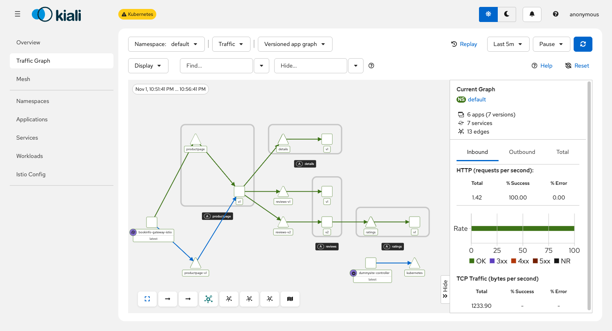
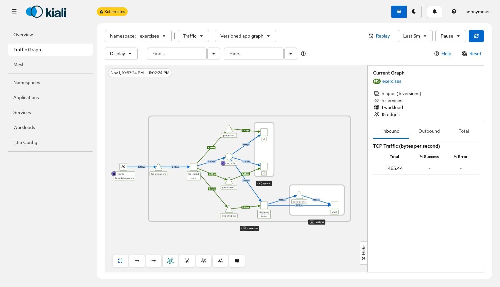

# Service mesh

[Istio](https://istio.io/) in ambient mode in the local k3d cluster (exercises 5.2 and 5.3). In ambient mode the pods have no sidecars: `ztunnel` on every node takes care of encrypted traffic and layer 4 policies, and a `waypoint` proxy takes care of layer 7 features such as HTTP policies and traffic splitting, only where it is asked for.

## Install (exercise 5.2)

Istio 1.31 follows the [getting started guide](https://istio.io/latest/docs/ambient/getting-started/), with the fixes below that this cluster needs.

```bash
brew install istioctl
colima ssh -- sudo sh -c 'printf "fs.inotify.max_user_instances=1024\nfs.inotify.max_user_watches=1048576\n" > /etc/sysctl.d/99-inotify.conf && sysctl -q -p /etc/sysctl.d/99-inotify.conf'
istioctl install --set profile=ambient --set values.global.platform=k3d \
  --set values.cni.cniBinDir=/var/lib/rancher/k3s/data/cni --skip-confirmation
```

| Problem | Symptom | Fix |
|---|---|---|
| Colima allows too few inotify instances for three nodes | `istio-cni-node` crashes with `too many open files` | Raise `fs.inotify.max_user_instances` in the VM |
| `global.platform=k3d` installs the CNI plugin to `/bin`, but k3s 1.37 looks for it in `/var/lib/rancher/k3s/data/cni` | **No new pod starts anywhere in the cluster**: `failed to find plugin "istio-cni"` | Set `values.cni.cniBinDir` |

The second one is worth knowing: the plugin is added to the CNI configuration of the whole node, so a wrong path breaks every namespace, not just the mesh. It is also a deadlock if it has already happened, since the corrected `istio-cni-node` cannot start either. Then copy the plugin by hand on each node once: `docker exec <node> cp /bin/istio-cni /var/lib/rancher/k3s/data/cni/istio-cni`.

The cluster keeps Traefik, which the guide turns off. The Gateway of the sample app is a `ClusterIP` and is reached with a port-forward, so the two do not compete for a port.

## The sample app

Bookinfo in the namespace `default`, following the guide until its clean up:

```bash
kubectl apply -f samples/bookinfo/platform/kube/bookinfo.yaml -f samples/bookinfo/platform/kube/bookinfo-versions.yaml
kubectl apply -f samples/bookinfo/gateway-api/bookinfo-gateway.yaml
kubectl annotate gateway bookinfo-gateway networking.istio.io/service-type=ClusterIP
kubectl label namespace default istio.io/dataplane-mode=ambient
kubectl port-forward svc/bookinfo-gateway-istio 8080:80
```

Kiali uses the Prometheus of [`../monitoring`](../monitoring), so `samples/addons/kiali.yaml` is changed as the exercise says, and Istio's own Prometheus addon is not installed:

```yaml
prometheus:
  enabled: true
  url: http://prom-prometheus-server.monitoring:80
```

```bash
kubectl apply -f samples/addons/kiali.yaml
kubectl port-forward svc/kiali -n istio-system 20001:20001   # http://localhost:20001/kiali
```



| Step of the guide | Tested | Result |
|---|---|---|
| Ambient on the namespace | `istioctl ztunnel-config workloads` | The pods use `HBONE`, without any restarts |
| Layer 4 policy: only the Gateway may call `productpage` | `curl` from another pod | Refused, exit code 56; through the Gateway `200` |
| Waypoint and layer 7 policy: only `GET` from the `curl` pod | `DELETE`, and `GET` from `reviews-v1` | `RBAC: access denied` for both; `GET` from `curl` works |
| Traffic split 90/10 with an HTTPRoute | 100 page loads | 96 to `reviews-v1`, 4 to `reviews-v2` |

## Log output in the mesh (exercise 5.3)

[Log output](../log-output) and [ping-pong](../ping-pong) run in the mesh in the namespace `exercises`, and Log output shows a greeting from the new [greeter](../greeter). The greeter has two versions, and the traffic to it is split so that version 1 gets 75% and version 2 gets 25%.

```
log-output → greeter-svc → waypoint ─ 75% → greeter-svc-1 → version 1
                                    └ 25% → greeter-svc-2 → version 2
```

```bash
docker build -t greeter:v5.3 ../greeter
docker build -t log-reader:v5.3 ../log-output/reader
k3d image import greeter:v5.3 log-reader:v5.3
kubectl apply -f exercises-mesh.yaml                # ambient mode and the waypoint
kubectl apply -f ../greeter/manifests/
kubectl apply -f ../log-output/manifests/deployment.yaml
curl http://localhost:8081/log-output
```

The pieces of the split:

- [`exercises-mesh.yaml`](exercises-mesh.yaml) labels the namespace and creates the waypoint. Splitting HTTP traffic is a layer 7 feature, so `ztunnel` alone cannot do it.
- [`../greeter/manifests/service.yaml`](../greeter/manifests/service.yaml) has three Services: `greeter-svc`, which the callers use, and `greeter-svc-1` and `greeter-svc-2`, which select one version each.
- [`../greeter/manifests/httproute.yaml`](../greeter/manifests/httproute.yaml) is an HTTPRoute whose parent is the Service `greeter-svc`, not a Gateway, and which divides the traffic by weight.

The applications did not change for any of this, apart from Log output calling the greeter.



Tested with 1 387 requests through the Ingress: version 1 answered 1 034 of them (74.5%) and version 2 answered 353 (25.5%). Kiali and Prometheus show the same ratio. All the pods of the namespace use `HBONE`, and joining the mesh restarted none of them.
